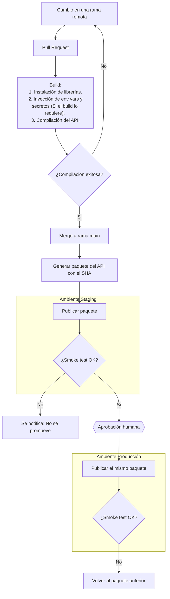

# Mapa de estrategia CI/CD - API de tareas

> Autor o autora: Gabriel Rodríguez Ovares
> Punto de partida: `docs/DESPLIEGUE_MANUAL.md`, el proceso manual que el pipeline va a reemplazar.
> Cómo se ve un mapa terminado: `docs/ejemplo-mapa-cicd-sitio.md` (otro caso, mismo método).
> Sintaxis de los diagramas: la Guía rápida de Mermaid (Moodle, material de apoyo).

## 1. Flujo de commit a producción

## 2. Ambientes

| Ambiente | Para qué sirve | Cómo llega un cambio | Quién decide que llegue |
|---|---|---|---|
| Local | Desarrollo del API y pruebas locales. | Quien desarrolla hace commits a una rama. | Quien desarrolla. |
| Staging | Verificar que los cambios introducidos no rompen funcionalidad existente, y que cumplen los criterios de aceptación. | Automático, después del merge a `main`. | Nadie: el pipeline. |
| Producción | La API que pueden utilizar otros aplicativos o clientes externos. | El mismo paquete que paso por staging. | Aprobador humano + pipeline. |

## 3. Riesgos del proceso manual y controles

| Paso | Riesgo | Qué puede pasar | Control del pipeline que lo atiende | Etapa del flujo |
|---|---|---|---|---|
| 1 | Entrar al servidor por SSH como `root` | Un atacante podría vulnerar el servidor de producción porque se tiene habilitado el acceso `root` | El pipeline se conecta de forma segura al servidor solo al momento de despligue | Despliegue |
| 2 | Traer últimos cambios con git pull, si hay conflicto borrar la carpeta y volver a clonar | Posible perdida de artefactos generados en el servidor; Confiar en que la última versión de Git ya fue probada por el equipo de desarrollo; Posible desincronización al querer hacer rollback. | Generar un paquete identificado por el SHA del commit y desplegar el mismo paquete probado en staging. | Build y Despliegue |
| 3 | Instalar dependencias sin versiones fijas | Una actualización incompatible puede impedir que la API arranque o alterar su comportamiento. | Fijar las versiones de las dependencias y construir el paquete una sola vez para promoverlo entre ambientes. | Build |
| 4 | Configuración del token manual | Exponer el token o intentar arrancar el API sin él | Gestionar el token como secreto, inyectarlo en el ambiente de ejecución y comprobar que esté configurado sin mostrar su valor. | Despliegue |
| 5 | Detener el servicio con comando `kill` | La API deja de responder mientras se inicia la nueva versión; pueden perderse solicitudes activas. | El pipeline no despliega hasta que todas las comprobaciones hayan pasado, el proceso de actualización no interrumpe solicitudes entrantes | Despligue |

## 4. Criterios de éxito

Qué tiene que ser verdad para decir que un despliegue salió bien, de forma que una máquina lo
pueda comprobar.

- La API responde `{"estado": "ok"}` al realizar la petición GET al endpoint `/health` en la URL del API desplegado.
- La API responde la versión de la app actual junto al `APP_ENV` producción al realizar la petición get al endpoint `/version`
- La API crea una nueva tarea de forma exitosa, con código 201 al mandar una petición POST al endpoint `/tareas` con el formato `{"titulo": "..."}`, título de menos de 120 carácteres y el encabezado `Authorization: Bearer <token>` con el `API_TOKEN` inyectado.
- Se crean tres tareas de ejemplo, las cuales se pueden consultar mediante el endpoint `/tareas/<id>`.

## 5. Decisiones y preguntas abiertas

- La aprobación humana va después de que el smoke test del entorno staging pasó, y antes de llegar a producción. El humano revisa lo que salió del pipeline, no lo que estaba en la computadora del desarrollador.
- Pregunta abierta: ¿En que horarios se despliega para evitar una posible afectación de usuarios?

Uso de IA: para hacer preguntas de aprendizaje para la sección de riesgos del proceso manual y controles para identificar que podría ocurrir.